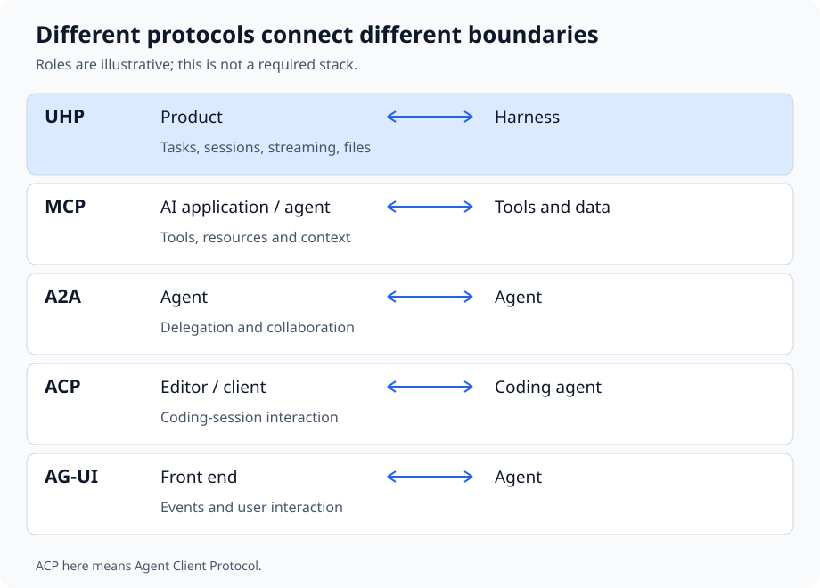

# UHP in the agent protocol ecosystem

This page is informative, not part of the UHP specification. The protocols below connect different parts of an agent system; the picture illustrates their roles, not a required architecture or a guarantee that every implementation interoperates.

## What each protocol connects

**[MCP (Model Context Protocol)](https://modelcontextprotocol.io/specification)** connects an AI application or agent to tools, data and other context exposed by servers. It describes what an agent can access or call, rather than the whole task a product asks a harness to run.

**[A2A (Agent2Agent Protocol)](https://a2a-protocol.org/latest/specification/)** connects agents so they can discover capabilities, delegate work and exchange results. Its boundary is collaboration between agents, rather than a product choosing and driving a harness.

**[ACP (Agent Client Protocol)](https://agentclientprotocol.com/)** connects an editor or other client to a coding agent, including the interaction around a coding session. Here ACP means *Agent Client Protocol*, not the unrelated *Agent Communication Protocol*.

**[AG-UI (Agent User Interaction Protocol)](https://docs.ag-ui.com/)** connects an agent to a front end through events used to present its work and support user interaction. It describes that interaction boundary, rather than how a server runs interchangeable harnesses.

**[UHP (Unified Harness Protocol)](versions/2026-10-19/index.md)** connects a product to a complete agent harness running a task. Its contract covers tasks, sessions, streaming, files and the results a client retrieves, while the harness owns its agent loop and tools.

## How they can combine

A product can submit a task through UHP to a server whose harness calls MCP tools: UHP's [Plugins chapter](versions/2026-10-19/plugins.md) describes how plugins carry MCP servers for the harness. An ACP adapter can also sit behind the UHP boundary; this repository's [ZeroClaw driver](https://github.com/HarnessRouter/harnessrouter/blob/fdadc18bab07c8b5212371d4dfc2dc4893896802/runner/zeroclaw_driver.py) starts the harness's own ACP server over standard input/output. A front end can use AG-UI events around an agent, and agents can collaborate through A2A, where those components support them. These are possible combinations, not features UHP requires every server to implement.
